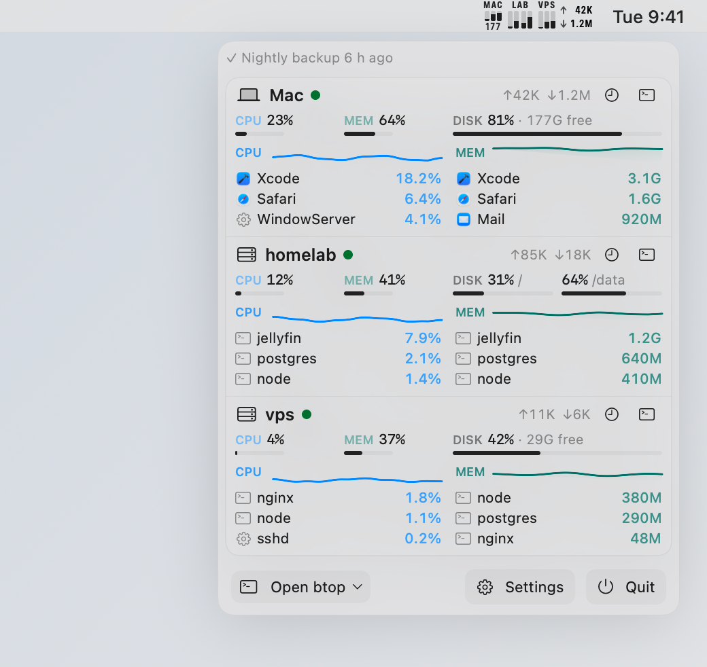
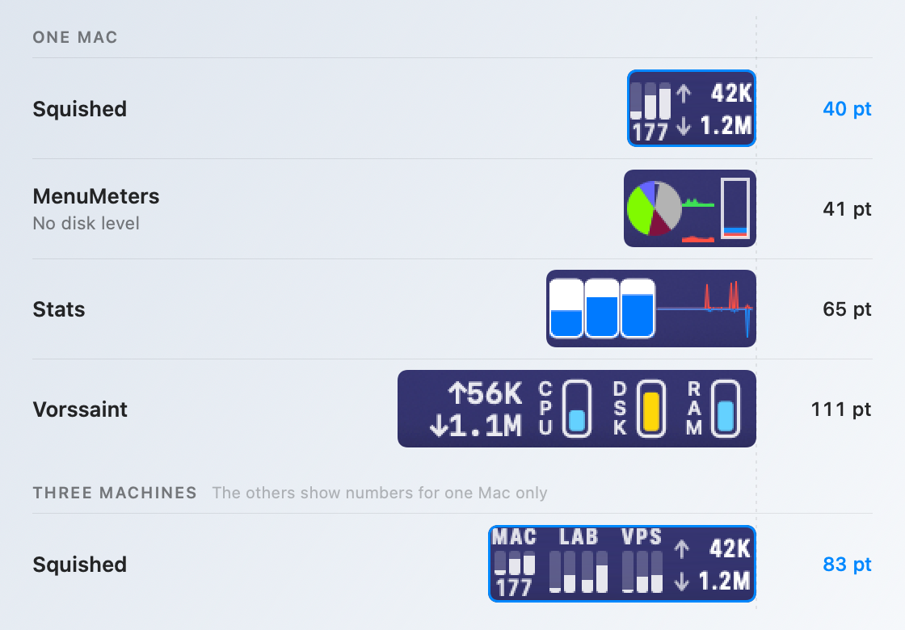
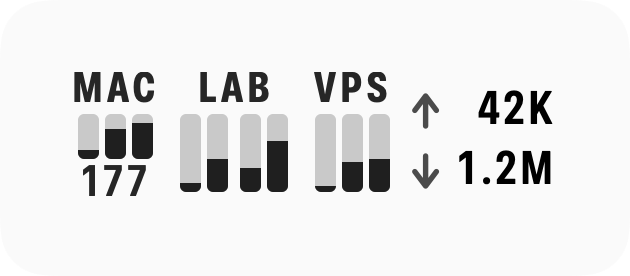

# Squished

**Super compact stats for your fleet.** Your Mac and your Linux servers, in the space of three menu bar icons.

[Visit the website →](https://squished.andrewkim.me/)

<picture>
  <source media="(prefers-color-scheme: dark)" srcset="docs/images/hero-dark.png">
  
</picture>

Every app wants a spot in the menu bar, a MacBook's notch takes the middle,
and whatever doesn't fit drops out of sight. A system monitor is often one of
the widest things up there. Squished is a small system monitor for macOS built
to take as little of that room as it can. It shows CPU, memory and disk for
your Mac **and** the Linux machines you already SSH into (a home server, a
NAS, a VPS), side by side in one menu bar item: about 40 points wide for one
Mac and 83 for three machines.

## How much room it takes

<picture>
  <source media="(prefers-color-scheme: dark)" srcset="docs/images/widths-dark.png">
  
</picture>

For one Mac, Squished takes as little room as the most compact monitor measured
here, with disk included. With two more machines added, it still fits within
the range the others use for one. Monitors that can watch several machines
usually put a single status icon in the menu bar and keep the numbers in a
dropdown.

Each app was set to show CPU, memory, disk and network in its most compact
built-in style (MenuMeters has no disk level), then measured and captured on
macOS 27.2 in November 2026. A width runs from the left edge of an app's first
menu bar item to the right edge of its last. Versions: MenuMeters 2.1.7,
Stats 3.1.0 and Vorssaint 3.4.4. The Squished rows are drawn from demo data at
its measured widths.

## What you get

- **Three bars per machine.** CPU, memory, disk. A free-space number appears
  under a disk only when it's getting full.
- **Nothing to install on your servers.** Squished uses your existing SSH
  setup and streams a small shell-and-awk script over the connection. No
  agent, no daemon, no extra open ports.
- **Quiet until it matters.** Bars change colour only for real trouble:
  memory pressure, a nearly full disk, CPU pinned for a while.
- **Click for the detail.** Top processes by CPU and memory, five minutes of
  history, network rates, disk partitions, uptime, and btop on any machine
  in one click (falls back to `top` if it can't find btop).

## Reading the menu bar

<picture>
  <source media="(prefers-color-scheme: dark)" srcset="docs/images/menubar-dark.png">
  
</picture>

Each machine gets a short label and three bars: CPU, memory and disk (up to
two disk bars). The number under the Mac's disk is free space in GiB, shown
because less than 30% is left. On the right are this Mac's upload and download
rates, which you can hide in **Settings → General**. When this Mac is the only
machine in the menu bar, its label is dropped and the bars use the full height.

## Install

Download [Squished.zip](https://github.com/andrewk17/squished/releases/latest/download/Squished.zip),
unzip it and move Squished.app to your Applications folder. It runs on macOS 14
or later, on Apple silicon and Intel Macs, and is signed and notarized by Apple.
Older versions are on the [releases page](https://github.com/andrewk17/squished/releases).

### Build from source

Use Xcode 16 or later (or another Swift 6 toolchain with a macOS SDK). Xcode 16
itself requires macOS 14.5 or later.

```sh
git clone https://github.com/andrewk17/squished.git
cd squished
Scripts/package-app.sh --install    # builds Squished.app and copies it to /Applications
open /Applications/Squished.app
```

## Add a machine

Open **Settings → Hosts** and add an alias from your `~/.ssh/config`. Squished
runs the system `ssh` in batch mode, so connect once to trust the host key
and make sure it accepts a key login without a prompt (a key loaded in your
SSH agent works).

Each machine has a **Show in menu bar** switch. Turn it off to keep a machine
in the panel without giving it room in the menu bar.

Remote machines need Linux with `/proc`, `sh`, `awk` and standard utilities
such as `df`. The sampler is tested on Ubuntu with gawk, mawk and BusyBox awk,
including fixtures from a Synology NAS.

## Optional cards

### Jobs

Any script can report into Squished by writing one small JSON file per job.
Useful for backups, cron jobs and long builds. Put it in
`~/Library/Application Support/Squished/jobs/`, for example `backup.json`:

```json
{
  "name": "Nightly backup",
  "status": "ok",
  "finishedAt": "2026-11-18T03:00:12Z",
  "durationSeconds": 412,
  "expectedEverySeconds": 86400,
  "message": "1.2 GB uploaded",
  "logPath": "~/Library/Logs/backup.log"
}
```

Only `name` and `status` (`ok`, `warning`, `failed` or `running`) are
required. A failed or overdue job adds a warning triangle to the menu bar.
A finished job is overdue after twice `expectedEverySeconds` since it
finished. A running job uses the time since its last update and twice the
longer of `expectedEverySeconds` and the last run's duration.

### Simulators and emulators

Running iOS Simulators on your Mac and Android emulators on your Mac or
Linux hosts get their own card, grouped by machine, with uptime when known
and a 12-hour timeline. To label devices on your Mac, for example with the
project each one belongs to, write
`~/Library/Application Support/Squished/devices.json`:

```json
{
  "devices": [
    { "id": "5B5793B6-BA84-4238-A768-342E4D62DE76", "label": "Storefront", "group": "QA" },
    { "id": "Pixel_8_API_35", "label": "Checkout", "group": "QA" }
  ]
}
```

Use the Simulator's UUID or the emulator's Android Virtual Device (AVD) name
as its `id`. Turn the card off in **Settings → General → Show Simulators and
emulators**.

## How it works

- On the Mac, Squished reads macOS's own counters. Nothing runs as root.
- For each remote machine it keeps one SSH connection open and runs a POSIX
  shell and awk sampler that reads `/proc` every two seconds by default and
  sends back a compact frame, typically under 2 KiB. Change the default in
  **Settings → General** or override it per host in **Settings → Hosts**.
  The script is sent each time it connects, so there is nothing on the
  server to install or update.
- Network totals count only while Squished is running.

## Is it for you?

Want detailed graphs for just your Mac? [Stats](https://github.com/exelban/stats)
does more. Want a dashboard for a whole rack of servers?
[Beszel](https://github.com/henrygd/beszel) does more. Squished is for glancing
at a handful of machines without leaving the menu bar.

## Build and test

```sh
swift build
swift test    # the core library and its tests also build and run on Linux
```

`Scripts/render-readme-images.sh` regenerates the hero, menu bar close-up and
width comparison images. The comparison uses the captures of other apps in
`docs/images/captures`.

## License

MIT. See [LICENSE](LICENSE).
